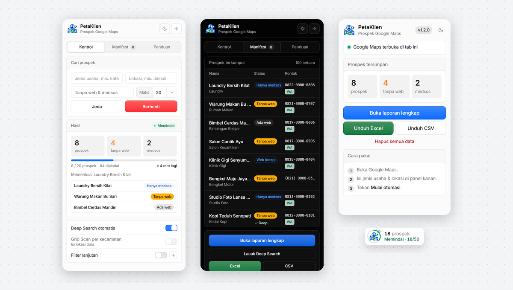
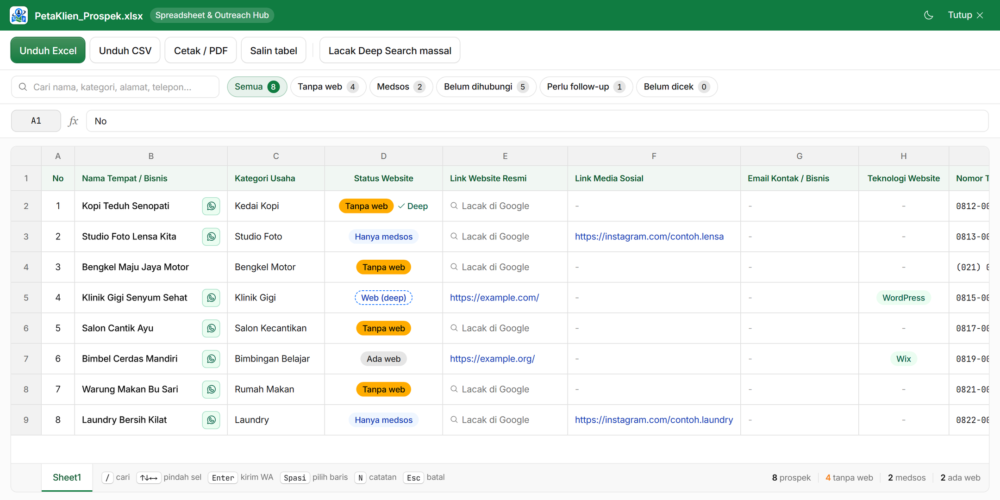
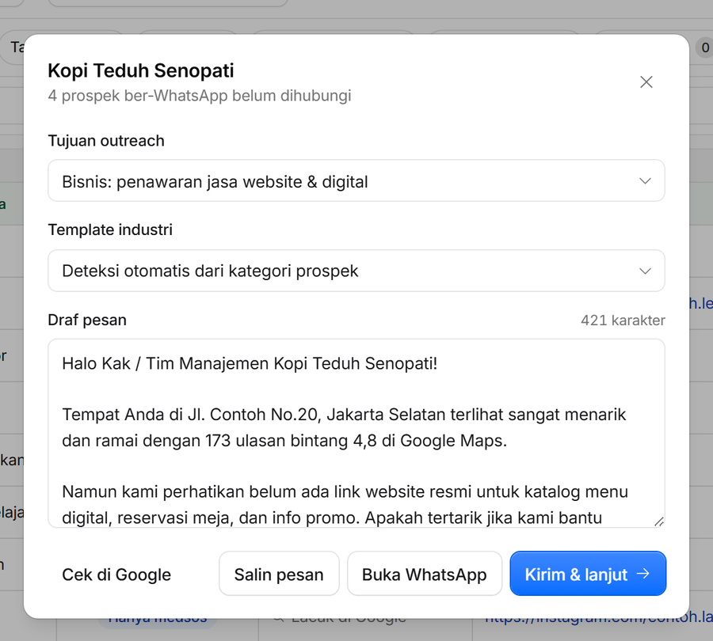
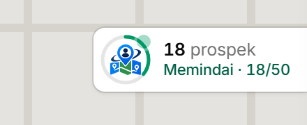

<div align="center">


# PetaKlien

**Kumpulkan prospek dari Google Maps, temukan yang belum punya website, lalu hubungi lewat WhatsApp, semuanya dari browser.**

Ekstensi Chrome untuk freelancer dan agensi yang mencari klien, juga mahasiswa yang mencari responden, tempat riset, atau magang.

[](https://github.com/NikeeTXC/PetaKlien/releases)
[](https://developer.chrome.com/docs/extensions/develop/migrate/what-is-mv3)
[](LICENSE)
[](#privasi-dan-izin)

[Demo](#demo) · [Fitur](#fitur) · [Instalasi](#instalasi) · [Cara pakai](#cara-pakai) · [FAQ](#pertanyaan-umum) · [Pengembangan](#pengembangan) · [Rilis](https://github.com/NikeeTXC/PetaKlien/releases)

<br />



</div>

## Demo

Dari mencari prospek sampai mengirim WhatsApp dan mengunduh Excel, dalam 40 detik:

https://github.com/user-attachments/assets/30d428f2-483c-4912-a96b-7db1d097a2d6

## Fitur

**Cari prospek**
- Memindai hasil Google Maps secara otomatis dan menyaring tempat yang **belum punya website** atau **hanya punya media sosial**.
- **Deep Search** mengecek ulang lewat Google Search, sehingga website yang tidak tercantum di Maps tetap ketahuan.
- **Grid Scan** memecah satu kota menjadi pencarian per kecamatan untuk hasil yang jauh lebih banyak (Jabodetabek, Bandung, Surabaya, Yogyakarta, Semarang, Malang, Bali, Medan, Makassar, dan lainnya).
- **Filter lanjutan**: khusus WhatsApp, rating, jumlah ulasan, kata kunci wajib atau dikecualikan, dengan preset satu klik.
- Membedakan nomor **HP/WhatsApp** dari telepon kantor, mendeteksi **email** dan **platform website** (WordPress, Shopify, Wix, dan lainnya).

**Hubungi prospek**
- Laporan bergaya spreadsheet dengan pencarian, filter cepat, urutan kolom, dan kolom nama yang tetap terlihat saat digeser.
- **Kirim & lanjut**: pesan WhatsApp siap kirim dari template per industri, status otomatis tercatat, lalu langsung ke prospek berikutnya.
- Template untuk penawaran jasa, riset skripsi, kuesioner, magang, kemitraan, atau template buatan sendiri.
- Mini-CRM: status outreach, catatan, pengingat follow-up, aksi massal, dan riwayat kontak yang tetap diingat walau data dikosongkan.

**Ekspor**
- Excel `.xlsx` 18 kolom yang rapi: header berwarna, hyperlink aktif, dan dropdown status outreach bawaan Excel.
- CSV, cetak ke PDF, dan salin tabel ke clipboard.

**Nyaman dipakai**
- Mode terang dan gelap, serta pintasan keyboard di halaman laporan.
- Panel boleh ditutup saat memindai; tombol di tepi kanan tetap menampilkan progres, dan Chrome memberi notifikasi saat target tercapai.
- Data yang terhapus bisa dibatalkan atau dipulihkan, dan Deep Search berhenti sendiri bila Google membatasi pencarian.

<table>
  <tr>
    <td width="58%"></td>
    <td width="42%"></td>
  </tr>
  <tr>
    <td align="center"><sub>Laporan lengkap: filter, status, dan WhatsApp di samping nama</sub></td>
    <td align="center"><sub>Outreach WhatsApp dengan Kirim &amp; lanjut</sub></td>
  </tr>
</table>

## Instalasi

1. Unduh `PetaKlien-v<versi>.zip` terbaru dari halaman **[Releases](https://github.com/NikeeTXC/PetaKlien/releases)**, lalu ekstrak.
2. Buka `chrome://extensions` dan aktifkan **Developer mode**.
3. Klik **Load unpacked**, lalu pilih folder hasil ekstrak (yang berisi `manifest.json`).

Berfungsi di Chrome, Edge, Brave, dan Opera.

Untuk memperbarui, unduh zip versi terbaru, timpa isi folder lama, lalu klik ikon muat ulang pada kartu PetaKlien di `chrome://extensions`. Data prospek tidak hilang karena tersimpan di Chrome, bukan di folder ekstensi.

## Cara pakai

1. Buka [Google Maps](https://www.google.com/maps). Panel PetaKlien muncul di sisi kanan.
2. Isi **jenis usaha** dan **lokasi**, misalnya `kafe` dan `Jakarta Selatan`. Bisa juga dikosongkan untuk memindai hasil pencarian Maps yang sedang terbuka.
3. Pilih kriteria (*Tanpa web & medsos*, *Tanpa web saja*, atau *Semua tempat*) dan **Maks**, yaitu jumlah prospek lolos kriteria yang ingin dikumpulkan. Lalu tekan **Mulai otomasi**.
4. Panel boleh ditutup. Tombol di tepi kanan tetap menampilkan progres:

   

5. Buka **laporan lengkap** dari tab Manifest untuk mengirim WhatsApp, mencatat follow-up, dan mengunduh Excel.

Tab **Panduan** di panel menjelaskan arti setiap status, fitur, dan pintasan keyboard.

### Arti status

| Label | Arti |
| :--- | :--- |
| **Tanpa web** | Tidak mencantumkan website. Target utama. |
| **Medsos** | Hanya punya Instagram, TikTok, Linktree, atau sejenisnya. |
| **Web (deep)** | Website ditemukan lewat Deep Search. |
| **Ada web** | Website tercantum di Google Maps. |
| **✓ Deep** | Sudah dicek lewat Google Search, memang tidak ada website. |
| **Belum dicek** | Deep Search dibatasi Google. Cek ulang lewat *Lacak Deep Search*. |
| **Pernah dihubungi** | Sudah pernah dikontak sebelum data dikosongkan. |

### Pintasan di laporan

`/` cari · `↑ ↓ ← →` pindah sel · `Enter` kirim WhatsApp · `Spasi` pilih baris · `N` catatan · `Esc` batal

<details>
<summary><b>Kolom file Excel (18 kolom)</b></summary>

<br />

| | Kolom | Isi |
| :-: | :--- | :--- |
| A | No | Nomor urut |
| B | Nama Tempat / Bisnis | Nama di Google Maps |
| C | Kategori Usaha | Kategori dari Google Maps, mis. *Kafe*, *Klinik Gigi* |
| D | Status Website | Tanpa web, Hanya medsos, atau Ada web (diberi warna) |
| E | Link Website Resmi | Link aktif, bisa diklik |
| F | Link Media Sosial | Instagram, TikTok, Linktree, dll. |
| G | Email Kontak / Bisnis | Jika ditemukan |
| H | Teknologi Website (CMS / Platform) | WordPress, Shopify, Wix, dll. |
| I | Nomor Telepon | Sesuai Google Maps |
| J | Tipe Kontak | Seluler (WhatsApp) atau telepon kantor |
| K | Link WhatsApp | Link `wa.me` siap klik |
| L | Alamat Lengkap | |
| M | Rating | Bintang di Google Maps |
| N | Jumlah Ulasan | |
| O | Status Outreach | Dropdown: Belum Dihubungi, Terkirim WA, Tertarik / Follow-Up, Deal (Klien), Ditolak |
| P | Link Google Maps | Link ke tempat tersebut |
| Q | Waktu Scrape | Kapan data diambil |
| R | Catatan | Catatan Anda dari halaman laporan |

</details>

## Pertanyaan umum

<details>
<summary><b>Panel PetaKlien tidak muncul di Google Maps</b></summary>

Muat ulang tab Google Maps. Jika baru memasang atau memperbarui ekstensi, muat ulang juga kartu PetaKlien di `chrome://extensions`.
</details>

<details>
<summary><b>Otomasi berhenti dengan peringatan "Google Maps berubah?"</b></summary>

Google sesekali mengubah tampilan Maps sehingga data tidak terbaca. Muat ulang halaman lalu coba lagi. Jika tetap terjadi, ekstensi perlu diperbarui; laporkan lewat [Issues](https://github.com/NikeeTXC/PetaKlien/issues).
</details>

<details>
<summary><b>Banyak prospek berstatus "Belum dicek"</b></summary>

Google membatasi pencarian otomatis, jadi Deep Search dihentikan agar tidak diblokir. Tunggu beberapa menit, lalu jalankan **Lacak Deep Search** dari tab Manifest.
</details>

<details>
<summary><b>Apakah data hilang saat ekstensi diperbarui atau Chrome ditutup?</b></summary>

Tidak. Data tersimpan di penyimpanan Chrome. Data hanya hilang jika Anda menghapusnya sendiri atau mencopot ekstensi, jadi unduh Excel secara berkala sebagai cadangan.
</details>

## Privasi dan izin

- Semua data disimpan **lokal** di browser (`chrome.storage`). Tidak ada server, akun, analitik, atau pelacakan.
- Izin yang diminta hanya `storage`, `unlimitedStorage`, dan `notifications`. Akses situs terbatas pada Google Maps dan Google Search.
- Font dan library disertakan di dalam ekstensi, tanpa request ke CDN.

## Pengembangan

Butuh [Node.js](https://nodejs.org/) 18 atau lebih baru.

```bash
npm install
npm test          # unit test + test ekstraksi terhadap cuplikan DOM Google Maps asli
npm run build     # test, verifikasi file & versi, lalu buat dist/PetaKlien-v<versi>.zip
npm run verify    # hanya verifikasi file & versi
```

Untuk mencoba perubahan, muat folder proyek langsung lewat **Load unpacked**.

<details>
<summary><b>Struktur proyek</b></summary>

```
├── manifest.json
├── src/
│   ├── background/   service worker: proxy Deep Search, notifikasi, jam tab tersembunyi
│   ├── content/      engine scraping (content.js) dan sidebar (overlay.js/.css)
│   ├── report/       halaman laporan, outreach, dan template pesan
│   ├── popup/        popup ekstensi
│   └── shared/       skema data 18 kolom, Deep Search, ekspor, tooltip
├── libs/             xlsx-js-style (penulis file Excel)
├── fonts/            Inter & JetBrains Mono
├── icons/
├── docs/images/      screenshot untuk README
├── scripts/          build-release.js
└── test/             unit & DOM test, fixture HTML Google Maps
```

</details>

Jika test DOM gagal setelah Google memperbarui tampilan Maps, rekam ulang fixture di `test/fixtures/` lalu sesuaikan selector di `src/content/content.js`. Saat dipakai, ekstensi juga menjeda otomasi dan memberi peringatan bila selector penting gagal berulang kali.

## Catatan penggunaan

PetaKlien mengotomasi interaksi dengan Google Maps dan Google Search, yang dapat bertentangan dengan [Ketentuan Layanan Google](https://policies.google.com/terms). Gunakan secukupnya dengan target yang wajar, dan hormati privasi pemilik usaha saat menghubungi mereka. Proyek ini tidak berafiliasi dengan Google.

## Masukan

Menemukan bug atau punya ide fitur? Buka [Issues](https://github.com/NikeeTXC/PetaKlien/issues). Sertakan versi PetaKlien (terlihat di popup) dan langkah untuk memunculkan masalahnya.

## Terima kasih

PetaKlien dibangun di atas karya open source berikut:

- **[Kumo](https://github.com/cloudflare/kumo)** dari Cloudflare, inspirasi tampilan dan komponen antarmuka
- **[Phosphor Icons](https://phosphoricons.com/)** untuk ikon
- **[xlsx-js-style](https://github.com/gitbrent/xlsx-js-style)** untuk membuat file Excel
- **[Inter](https://github.com/rsms/inter)** dan **[JetBrains Mono](https://github.com/JetBrains/JetBrainsMono)** untuk huruf

## Lisensi

Dirilis di bawah [Lisensi MIT](LICENSE).
